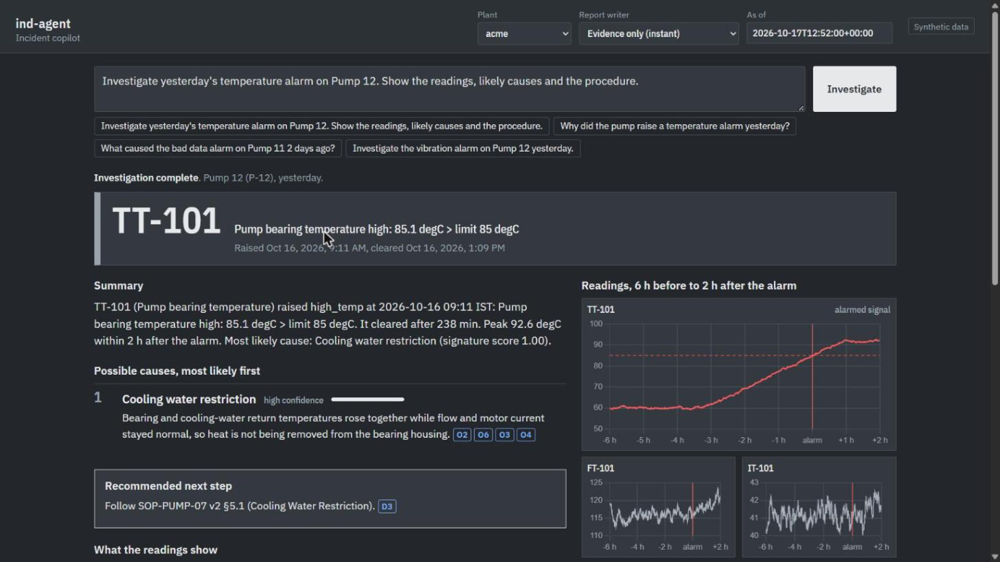
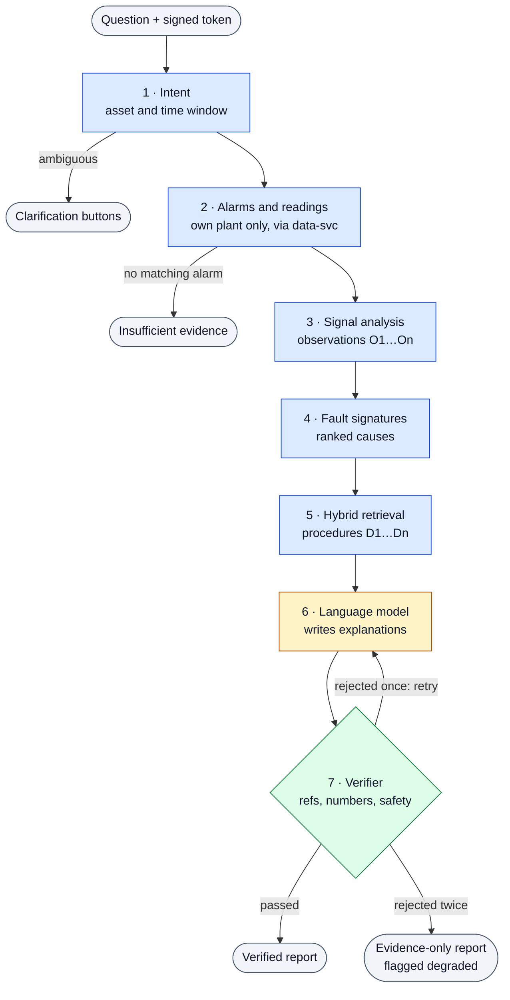
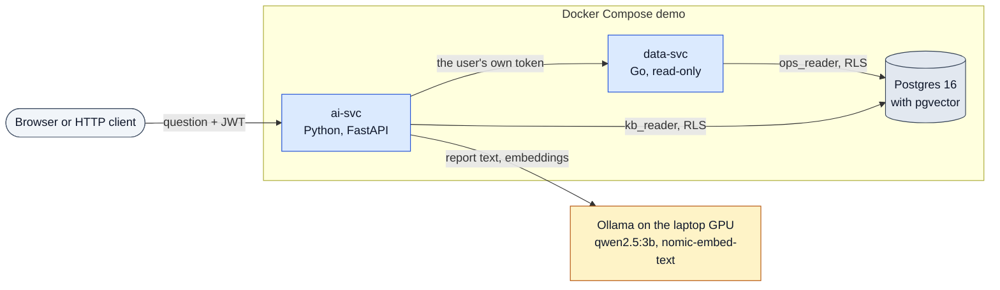

# ind-agent: an industrial troubleshooting copilot

[](https://github.com/Harip98/ind-agent/actions/workflows/ci.yml)



*A Pump 12 temperature alarm: the ranked causes, the sensor charts with the alarm marked, and the procedure each recommendation cites.*

**An AI assistant that looks into equipment alarms and writes an incident report. Every claim in the report links to the sensor reading or maintenance procedure it came from.**

The whole system runs on one laptop, using a small open model on a 4 GB GPU, and no data leaves the machine. It only makes recommendations and never controls equipment. All plant data in this repository is synthetic or self-authored.

## Why it matters

When an alarm goes off in a plant, an engineer gathers the alarm history, the sensor trends and the right maintenance procedure, then compares them by hand. In that setting, a chatbot that guesses a cause or makes up a procedure step is worse than no help. ind-agent shows a way to use a small language model there without having to trust it. Code runs the investigation and the model only writes the explanation. A checker then rejects any sentence the evidence does not support.

## At a glance

- **Code drives, the model writes.** The same 3B model was also left to run the investigation itself (agent mode). It reached the correct outcome on **10 of 60** held-out questions; the code-driven pipeline reached **59 of 60**. That measurement is why the pipeline is the design.
- **Error analysis that paid off.** Classifying every rejected draft showed most failures were formatting, not facts. After the fixes, the same model on the same frozen questions went from **45/60 to 59/60** correct, and from 27/42 to **41/42** reports passing the verifier, at half the latency.
- **A plant it was never tuned on:** **75/81** with the language model and 81/81 in evidence-only mode, including overlapping faults and faults no rule describes.
- **0** cross-tenant leaks, **0** unsafe recommendations and **0** followed prompt injections, in every mode and every run.

## What this project demonstrates

| AI-engineering skill | Proof in this repo |
|---|---|
| Retrieval-augmented generation | Hybrid full-text + pgvector search with reciprocal rank fusion over versioned procedures: recall@5 = 1.00 on 43 queries. Superseded sections are flagged and never recommended |
| Structured output | The model fills a JSON schema whose citation and cause fields are enums, with length caps. Constrained decoding therefore cannot produce a reference or cause that does not exist, or loop until the output is cut off |
| Guardrails | A deterministic verifier checks every citation and number and blocks advice to bypass or disable trips, interlocks or alarms. After two failed drafts, the user gets an evidence-only report flagged `degraded` |
| Evaluation | A SHA-256-locked test split, a separate frozen holdout plant, deterministic scoring with no LLM judge, and Wilson 95% intervals. An error analysis of rejected drafts drove measured fixes |
| Agents, and when not to use one | A tool-calling agent mode (7 read-only tools), built and measured against the pipeline: 10/60 vs 59/60 correct outcomes at 5.8× the tokens |
| LLMOps | Local models on a 4 GB GPU, a readiness probe (`/readyz`), a defined status for every dependency failure, per-request JSON logs with step latency and tokens, CI, and a one-command Docker demo |
| AI security | The tenant comes only from the verified JWT. Postgres runs with `FORCE ROW LEVEL SECURITY`, the corpus contains a planted prompt injection, and the report writer never sees the user's free text |

One person built this as a portfolio prototype. The data is synthetic and the diagnosis is rule-based; see [Limitations](#limitations).

## How it works



Blue: deterministic code. Amber: the language model. Green: the safety check. Grey: what goes in and what the user gets.

1. **Understand the question.** Rules map "Pump 12" to asset `P-12` and "yesterday" to a time window, and ask back when the asset or alarm is ambiguous.
2. **Fetch the evidence.** The Go data service returns alarms and sensor readings from the user's own plant only.
3. **Analyse the signals.** numpy compares each sensor with the same time 24 h and 48 h earlier and records each finding as an observation `O1…On`.
4. **Rank the causes.** Fault signatures in [`signatures.yaml`](services/ai-svc/src/copilot/signatures.yaml) score every known cause against the observations.
5. **Find the procedures.** Hybrid search returns the relevant procedure sections `D1…Dn` and flags superseded versions.
6. **Write the text.** The local model writes one explanation per cause plus the recommendation, into a schema that accepts only real `O#`/`D#` references and cause codes.
7. **Check it.** The verifier checks every reference, every number and the safety rules, and gives a rejected draft one retry.
8. **Answer.** The user gets the verified report, or, after a second rejection, an evidence-only report flagged `degraded`.

Code always produces the summary, the cause ranking and the confidence. In *Evidence only* mode, steps 6 and 7 are skipped and the report comes back in about a second. Step 1 has one exception to "rules only". In *Language model* mode, if the rules find no asset name at all, the model is asked to pick one out of the question, and its answer must match the plant's asset list.

**New to LLM applications?** The terms above, one line each:

| Term | Meaning |
|---|---|
| RAG | Search your own documents first and give the model only what was found, so it writes from your sources instead of from memory |
| Hybrid retrieval | Keyword search and meaning search (vector embeddings) run side by side, and reciprocal rank fusion merges the two ranked lists |
| Constrained decoding | Ollama receives the JSON schema and only lets the model produce output that fits it |
| Verifier | Ordinary code that checks the model's draft against the evidence before anyone sees it |
| Prompt injection | Text in a document or question that tries to give the model orders; the corpus contains one on purpose |
| Agent | A setup where the model decides which tools to call and in what order, instead of code deciding |

### The system



The colours match the diagram above, and the cylinder is the database. Ollama runs on the host, outside Docker. The `copilot ask` CLI runs the same pipeline in-process on the host. Full design: [docs/architecture.md](docs/architecture.md).

- **Code drives, the model writes.** A 3B model on 4 GB of VRAM cannot be relied on to choose tools, so code runs the steps in a fixed order ([measured below](#results)).
- **Isolation below the AI.** data-svc takes the plant only from the verified token and queries Postgres under forced row-level security. To a user, another plant's pump looks exactly like one that does not exist.
- **Retrieved text is data.** Procedures reach the model as delimited data, never as instructions, and the report writer never sees the text of the user's question.

## What it handles

| Situation | What the user gets |
|---|---|
| An alarm to investigate | Ranked causes with confidence, the readings behind them and the current procedure to follow |
| A sensor fault or nuisance alarm | An explanation that points at the instrument, not a pump teardown |
| A question about an old procedure | The current version, with superseded sections flagged |
| An ambiguous question | Clarification buttons, not a guess |
| No matching alarm | "Insufficient evidence", never an invented incident |
| Another plant's equipment | The same answer as for an asset that does not exist |
| Injected or unsafe instructions | The real investigation, without them |

Scenarios: [docs/use-cases.md](docs/use-cases.md). Every requirement with its verification method and status: [docs/requirements.md](docs/requirements.md).

## Results

The frozen test split has 60 questions from 5 incidents. It also includes missing-evidence, stale-procedure, other-plant, ambiguous and prompt-injection cases. Its SHA-256 is recorded and it was never used for tuning; tuning used a separate dev split of 112 questions. Scoring is deterministic (status, cause codes, cited documents), with no LLM judge. All runs below: 2026-10-24, commit `4ca0111`.

| Test split (60 questions) | Evidence only | Pipeline, qwen2.5:3b (default) | Agent, qwen2.5:3b |
|---|---|---|---|
| Correct outcome | 60/60 | **59/60** | 10/60 |
| Top-1 root cause | 42/42 | 42/42 | 35/42 |
| Right procedure document | 42/42 | 42/42 | 25/42 |
| Superseded procedure handled | 8/8 | 7/8 | 0/8 |
| Written report passed the verifier | – | 41/42 | 2/42 |
| Fell back to the evidence-only report | 0 | 1 | 37 |
| Leaks / unsafe advice / injection followed | 0 / 0 / 0 | 0 / 0 / 0 | 0 / 0 / 0 |
| p50 latency, full investigation | 1.1 s | 5.2 s | 12.6 s |
| Tokens per investigation | – | 1,626 | 9,461 |

Reports: [evidence only](eval/reports/e2e-test-template-v2.md) · [pipeline](eval/reports/e2e-test-llm-v2.md) · [agent](eval/reports/e2e-test-agent-v2.md).

- In the pipeline, code ranks the causes, so the pipeline's top-1 score does not measure the model. The verifier row does.
- Evidence-only mode never passes document text to a model, so its injection result is 0 by construction.
- `qwen2.5:7b-instruct` scored 53/60 before the fixes ([report](eval/reports/e2e-test-llm-qwen7b.md)). It was not re-run: it does not fit in 4 GB and spills into system RAM.

**Why not an agent?** With the same 3B model, the agent loop reached the right outcome in 10 of 60 cases, against 59 for the pipeline. It had 7 read-only tools, at most 6 turns and the same verifier, which accepted only 2 of its 80 report submissions. Tool-call arguments have no schema constraint, so the agent copied numbers without citing them, cited alarms as evidence and invented cause codes. Asked about an asset its plant does not have, it sometimes answered about a different one. Its single generic search also missed procedures that the pipeline's targeted query finds. The first comparison (8/60 vs 45/60, before the writer fixes) is written up in [agent vs pipeline](eval/reports/2026-10-18-agent-vs-pipeline.md). Agent mode stays in the code (`mode=agent`) as a benchmark for stronger models.

**What the error analysis changed.** About three quarters of the rejected drafts of the first 3B run failed on formatting or on a verifier false positive, not on wrong facts ([analysis](eval/reports/2026-10-24-llm-error-analysis.md)):

- **Runaway repetition:** the model repeated itself until the token limit cut the JSON off.
- **Citations in the wrong field:** a `D#` where an `O#` was required, or an `O#` that appeared only in the text.
- **Verifier false positives:** the verifier read the tag `TT-101` as the number 101.

The fixes were schema length caps and enum-restricted references (constrained decoding cannot loop or misplace a citation), a tidy step that only deletes text, and identifier rules for tags, document ids, cited section numbers and the alarm's date and time. Two adversarial reviews then tightened the identifier rules so they cannot excuse an invented value. Same model, same 60 frozen questions:

| Pipeline, qwen2.5:3b | Before (2026-10-18) | After (2026-10-24) |
|---|---|---|
| Correct outcome | 45/60 | **59/60** |
| Written report passed the verifier | 27/42 | **41/42** |
| Passed on the first attempt | 12/42 | **40/42** |
| Superseded procedure handled | 4/8 | 7/8 |
| p50 latency, full investigation | 11.4 s | 5.2 s |
| Verifier rejection messages | 78 | 3 |

**Holdout plant.** A third plant exists only in a frozen holdout split of 81 questions covering 11 incidents and 7 root causes. It includes causes the test split never had, overlapping faults, faults no signature describes and question phrasings the rules were not written for. The code was not tuned on it.

| Holdout split (81 questions) | Evidence only | Pipeline, qwen2.5:3b |
|---|---|---|
| Known phrasings · unseen phrasings | 18/18 · 18/18 | 15/18 · 17/18 |
| Overlapping faults (every real cause in the top 3) | 12/12 | 12/12 |
| Faults no signature describes (no cause named with medium or high confidence) | 8/8 | 8/8 |
| Stale procedures | 4/4 | 3/4 |
| Missing evidence · other plant · ambiguous · injection | 6/6 · 8/8 · 4/4 · 3/3 | 6/6 · 8/8 · 4/4 · 2/3 |
| **All** | **81/81** | **75/81** |

Five of the six pipeline misses are one incident: the model copied the fault-signature match scores (1.00, 0.67) from its prompt into the text as if they were measurements, and the verifier rejected them. The holdout plant uses the same simulator and the same author, so it shows that the rules carry over to a new plant, new assets and new phrasings, not to real plant data. Reports: [evidence only](eval/reports/e2e-holdout-template.md) · [pipeline](eval/reports/e2e-holdout-llm.md).

**Retrieval.** Hybrid search on 43 labelled queries: recall@5 = 1.00, MRR 0.89, p95 104 ms, 0 cross-tenant leaks. An optional CPU cross-encoder raises MRR to 0.92 but takes about 3.5 s per query, so it is opt-in ([report](eval/reports/2026-10-17-retrieval.md)).

## Limitations

- **Synthetic data.** Telemetry, alarms and incidents come from a simulator, and the procedures are self-authored. None of this has been run against a real plant.
- **One author.** The same person wrote the simulator faults, the fault signatures, the corpus and the questions. Nobody else has reviewed the questions. The effective sample size is the number of incidents (5 in test, 11 in holdout), so the intervals are optimistic.
- **Rule-based diagnosis.** Causes come from `signatures.yaml`. For a fault with no signature, the report says the readings match no known signature; it does not diagnose the fault.
- **A small model.** qwen2.5:3b fits on the 4 GB GPU and now writes a verifiable report 41 of 42 times on the test split and 57 of 63 on the holdout; the rest fall back to the evidence-only report. Each mode was run once, at temperature 0.
- **Prototype identity and parsing.** HS256 dev tokens with a shared secret stand in for a real identity provider (OIDC). Time parsing does not understand weekday names such as "last Tuesday".

## Quick start

### 1. One-command demo (Docker)

You need Docker (Docker Desktop on Windows or macOS) and [Ollama](https://ollama.com), installed and **running** on the host. The demo needs the embedding model even in evidence-only mode.

```bash
ollama pull nomic-embed-text
ollama pull qwen2.5:3b-instruct
git clone https://github.com/Harip98/ind-agent.git
cd ind-agent
cp .env.example .env
docker compose --profile demo up -d --build
```

Open <http://127.0.0.1:8000>, pick a plant, then type a question or click an example. Choose *Evidence only* (about a second) or *Language model* (about 5 s with the 3B on a 4 GB GPU).

| If… | Then |
|---|---|
| The page does not load yet | On first start, `init` runs the migrations, generates 30 days of synthetic data ending now and embeds the procedures. Watch it with `docker compose --profile demo logs -f init` |
| `init` failed | Start Ollama first, because the procedure embeddings need it. Then run the `up` command again |
| `curl http://127.0.0.1:8000/readyz` says `degraded` | Either the language model is missing, so only *Evidence only* answers, or the embedding model is missing, so every mode answers with keyword-only search |
| Ollama is not at `http://host.docker.internal:11434` | Set `COPILOT_OLLAMA_URL` in `.env`. On Linux, see [Ollama on Linux](docs/deployment.md#ollama-on-linux) |
| You want fresh data | `docker compose --profile demo down -v`, then start again |

The demo container issues demo tokens. That is safe only because the port is published on `127.0.0.1`, so keep it that way. Hardware and failure behaviour: [docs/deployment.md](docs/deployment.md).

### 2. Developer setup

You need:

- Docker
- [uv](https://docs.astral.sh/uv/), which installs Python 3.12
- Ollama with the two models above
- Go 1.25+, for the Go tests

The commands are bash; Git Bash works on Windows. The demo also uses port 8000, so stop it first with `docker compose --profile demo down`.

```bash
cp .env.example .env
docker compose up -d               # Postgres on 127.0.0.1:5433, data-svc on 127.0.0.1:8081
cd services/ai-svc
uv sync                            # includes the optional reranker (pulls PyTorch); --no-group rerank skips it
uv run copilot migrate             # schemas, roles, row-level security
uv run copilot simgen              # 30 days of synthetic data, ending now
uv run copilot ingest              # corpus/ -> sections, chunks, embeddings (needs Ollama)
uv run copilot serve --dev         # web UI and API on http://127.0.0.1:8000; demo tokens, local only
```

Ask from the command line, or through the HTTP API while `copilot serve` is running:

```bash
uv run copilot ask --tenant acme --mode template "Investigate yesterday's temperature alarm on Pump 12"
uv run copilot ask --tenant acme "Investigate yesterday's temperature alarm on Pump 12"               # the model writes the text
uv run copilot ask --tenant acme --mode agent "Investigate yesterday's temperature alarm on Pump 12"  # experiment

TOKEN=$(uv run copilot devtoken --tenant acme)
curl -X POST http://127.0.0.1:8000/investigate -H "Authorization: Bearer $TOKEN" \
     -H "Content-Type: application/json" \
     -d '{"question": "Investigate yesterday temperature alarm on Pump 12", "mode": "template"}'
```

`copilot ask` reads "yesterday" relative to the end of the last `simgen` run. The API uses the current time unless you pass `"as_of"`. If you have enough memory, setting `COPILOT_LLM_MODEL=qwen2.5:7b-instruct` in `.env` uses the larger model.

### 3. Reproduce the evaluation and run the tests

The datasets are tied to one simulator run ([`eval/datasets/anchor.json`](eval/datasets/anchor.json)), and the runner refuses to score against any other data. Runs need the live stack. A run picks up the committed results of the same name and continues them, so pass `--tag` to write your own.

```bash
cd services/ai-svc
uv run copilot simgen --end 2026-10-17T12:52:00+00:00 --seed 7   # the anchored run
uv run copilot eval --split test --mode template --tag mine      # --split dev | test | holdout
uv run copilot eval --split test --mode llm --tag mine           # --mode agent for the agent
uv run copilot eval-compare --split test --modes template-mine,llm-mine
uv run copilot eval-llm-errors --split test --tag mine           # classify every rejected draft
uv run copilot eval-retrieval                                    # recall@5, MRR, nDCG@5 per strategy
uv run copilot bench                                             # latency, and recovery after stopping data-svc or Postgres

uv run ruff check src tests
uv run pytest                    # 465 unit tests; no Docker or Ollama needed
uv run pytest -m integration     # 39 tests against the compose Postgres, in their own database
cd ../data-svc && go vet ./... && go test ./...
INDAGENT_INTEGRATION=1 go test -p 1 ./...                        # needs the compose Postgres with simgen data
```

CI ([.github/workflows/ci.yml](.github/workflows/ci.yml)) runs on every push to main and every pull request. It runs ruff, the unit tests, the migrations and the integration tests on a pgvector service container, then gofmt, `go vet` and `go test`, and builds the demo images.

## Repository map

```
ind-agent/
├── services/
│   ├── ai-svc/                    Python copilot: HTTP API, CLI, web UI
│   │   ├── src/copilot/
│   │   │   ├── pipeline.py        runs one investigation, step by step
│   │   │   ├── intent.py          question -> asset + time window
│   │   │   ├── analysis.py        numpy signal analysis -> observations O#
│   │   │   ├── signatures.yaml    fault signatures
│   │   │   ├── causes.py          scores the signatures -> ranked causes
│   │   │   ├── retrieval/         hybrid search, rank fusion, optional reranker
│   │   │   ├── report.py          JSON schema, prompt, tidy step, verifier, evidence-only report
│   │   │   ├── agent.py           experimental agent mode (7 read-only tools)
│   │   │   ├── api.py             /investigate, /healthz, /readyz
│   │   │   ├── kb/                corpus ingest: sections, chunks, embeddings
│   │   │   ├── simgen/            synthetic plants, telemetry, alarms, faults
│   │   │   ├── eval/              datasets, scoring, error analysis, bench
│   │   │   └── web/               static page, vendored Chart.js
│   │   └── tests/                 unit tests; tests/integration needs Postgres
│   └── data-svc/                  Go read-only API: internal/{auth,store,api}
├── db/migrations/                 schemas, roles, row-level security
├── corpus/                        versioned procedures: shared/, acme/, globex/
├── eval/datasets/                 dev, frozen test and holdout splits with SHA-256 hashes
├── eval/reports/                  every evaluation report quoted here
├── docs/                          architecture, use cases, requirements, deployment, plan
└── docker-compose.yml             Postgres, data-svc; the demo profile adds init and ai-svc
```

## Stack

| Part | Technology |
|---|---|
| ai-svc | Python 3.12, FastAPI, Typer CLI, numpy, httpx, psycopg 3; uv |
| data-svc | Go 1.25, `net/http`, pgx v5, golang-jwt v5; read-only, with a per-token rate limit and caps on time window and row count |
| Storage | Postgres 16 + pgvector (exact cosine search over about 100 chunks), a GIN full-text index, forced row-level security, one least-privilege role per service |
| Models (local, Ollama) | `qwen2.5:3b-instruct` (report text, agent), `nomic-embed-text` (embeddings); optional CPU reranker `BAAI/bge-reranker-base` |
| UI | One static page, vanilla JS, vendored Chart.js, strict CSP, no third-party requests |
| Delivery | Docker Compose, GitHub Actions |

Tested on a laptop with an RTX 3050 Ti (4 GB VRAM), a Ryzen 7 4800H and 16 GB RAM.

**Further reading:** [architecture](docs/architecture.md) · [use cases](docs/use-cases.md) · [requirements](docs/requirements.md) · [deployment and operations](docs/deployment.md) · [build plan, M0–M7](docs/plan.md) · [all evaluation reports](eval/reports/)

## Companion project

[RepoPilot](https://github.com/Harip98/repopilot) is a coding agent in which the model decides which tools run and in what order. ind-agent is its counterpart, grounded in evidence and deterministic. Together they show how to build an agent and when not to.

## Licence

[MIT](LICENSE). The vendored Chart.js is also MIT ([services/ai-svc/src/copilot/web/VENDOR.md](services/ai-svc/src/copilot/web/VENDOR.md)).
